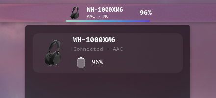
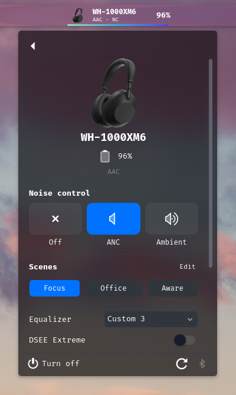
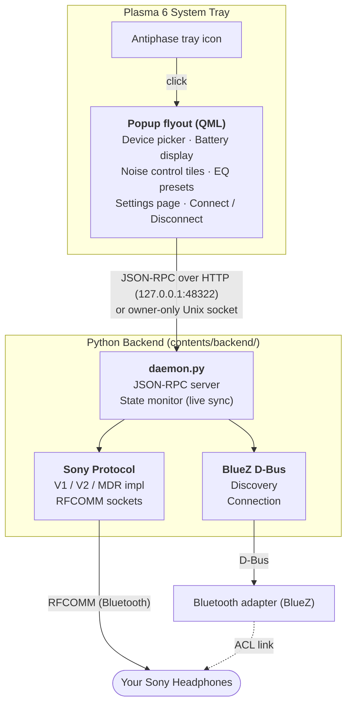

# Antiphase — Plasma 6

> **Antiphase** is the physics of noise cancelling: a second signal, played *in
> anti-phase*, destructively interferes with the noise and cancels it. This
> applet does the same trick from your desktop — silence on demand from the
> tray.

A **system tray applet** for Plasma 6 that lets you control your Sony headphones directly from the desktop — battery, noise cancelling, equalizer, and more — without needing the Sony Headphones Connect mobile app.

Built as a Plasma 6 plasmoid (QML frontend + Python backend).

> "Sony", "Sony Headphones Connect" and related marks are trademarks of Sony
> Group Corporation. This is an unofficial, independent project; it is not
> affiliated with, authorized by, or endorsed by Sony. The names are used only
> to describe compatibility.

## Screenshots

| | |
|:---:|:---:|
|  |  |
| **Tray & device list** — the wide tray cell shows model, codec, noise mode and battery at a glance; the popup lists paired Sony headphones with live status. | **Device detail** — noise-control tiles, Adaptive Sound Control scenes, equalizer and DSEE, with a Settings page (Speak to Chat, Auto Power-Off, firmware) behind the gear and the pinned power / refresh / Bluetooth bar. |

## Features

| Feature | Details |
|---|---|
| **Battery** | Main, left/right earbud, case levels + charging state |
| **Live Sync** | On-device changes (NC button, power-off, codec, battery) reach the tray within seconds via the daemon's state monitor |
| **Noise Control** | Off / ANC / Ambient with level slider + Focus on Voice toggle |
| **ASC Scenes** | Editable Focus / Office / Aware presets (persisted by the daemon) |
| **Equalizer** | Presets + custom curve: 10-band editor on MDR (XM6), 5-band + Clear Bass on V1/V2 |
| **DSEE** | Enable/disable Sony audio upscaling |
| **Settings page** | Speak to Chat, Adaptive Volume and Auto Power-Off on the device itself, plus an About section with the firmware version — rows appear per model capability |
| **Codec** | Shows the active codec (LDAC / AAC / SBC) |
| **Device Detection** | Auto-discovers paired Sony headphones via BlueZ; Connect buttons on the list and detail page, with automatic session re-establishment |
| **Tray Layouts** | Icon, icon + battery %, or product render + name + status; auto-sizing |

## Supported Devices

| Device | Protocol | Status |
|---|---|---|
| WH-1000XM6 | MDR (COMMAND_1) | ✅ Verified on real hardware (battery, noise control, EQ, DSEE, codec, ASC scenes, Speak to Chat, Auto Power-Off, firmware) |
| WH-1000XM3 | V1 | 🧪 Implemented, untested |
| WH-1000XM4 | V1 | 🧪 Implemented, untested |
| WH-1000XM5 | V2 | 🧪 Implemented, untested |
| WF-1000XM4 | V2 | 🧪 Implemented, untested |
| WF-1000XM5 | V2 | 🧪 Implemented, untested |
| WF-1000XM6 | V2 | 🧪 Implemented, untested |
| WH-CH720N | V2 | 🧪 Implemented, untested |
| ULT WEAR | V2 | 🧪 Implemented, untested |
| LinkBuds S | V2 | 🧪 Implemented, untested |

> ⚠️ **Unofficial** — This project is not affiliated with, associated with, authorized by, or endorsed by Sony Group Corporation.

## Architecture



### Tech Stack

- **Frontend**: QML / Qt Quick (Plasma 6 Kirigami)
- **Backend**: Python 3.12+ with `dbus-python`
- **Bluetooth**: BlueZ via D-Bus + raw RFCOMM sockets
- **Protocol**: Reverse-engineered Sony MDR protocol (V1 & V2)

## Prerequisites

A Plasma 6 desktop, Bluetooth, and two packages:

```bash
# Arch
sudo pacman -S qt6-base python-dbus

# Debian/Ubuntu (Plasma 6 is in 24.04+ backports / Debian 12+)
sudo apt install qml6-module-org-kde-plasma-plasmoid python3-dbus
```

`python-dbus` is usually already installed on Plasma systems.

### Python dependencies

The daemon uses only the standard library plus `dbus-python` (already on a
Plasma system). The development scripts (`scripts/qmlcheck.py`,
`scripts/preview.py`) additionally need PyQt6 (`python-pyqt6`) — not
required at runtime.

## Installation

### Quick install (recommended)

```bash
git clone https://github.com/shy-doge/antiphase.git
cd antiphase
./install.sh
```

The script checks dependencies, installs the widget, copies the daemon
backend to `~/.local/share/antiphase/backend`, registers it as a systemd
user service (`antiphase.service`, auto-restart on crash; autostart entry
on systems without a systemd user instance) and starts it right away.
Re-run it any time to update (`git pull && ./install.sh`).

> The repo is pure source: after installing you can rename, move or even
> delete the checkout without breaking the daemon. Just re-run `install.sh`
> after changing the backend code.

Then add the widget to the panel:

1. Right-click the panel → **Enter Edit Mode** → **Add Widgets**
2. Search for **"Antiphase"**, drag it into the system tray area

To remove everything: `./uninstall.sh` (add `--purge` to also delete your
saved scenes).

### Manual install

<details>
<summary>Step by step, if you prefer doing it yourself</summary>

**1. Install and start the daemon** (required — the widget talks to it
over loopback). Copy the backend somewhere stable so the checkout can be
moved later:

```bash
mkdir -p ~/.local/share/antiphase/backend
cp contents/backend/*.py ~/.local/share/antiphase/backend/
python3 ~/.local/share/antiphase/backend/daemon.py &
```

For autostart, create `~/.config/systemd/user/antiphase.service`:

```ini
[Unit]
Description=Antiphase Sony headphone daemon

[Service]
ExecStart=python3 ~/.local/share/antiphase/backend/daemon.py
Restart=on-failure
RestartSec=2

[Install]
WantedBy=default.target
```

then `systemctl --user daemon-reload && systemctl --user enable --now antiphase.service`.

**2. Install the plasmoid:**

```bash
mkdir -p ~/.local/share/plasma/plasmoids/com.github.antiphase
cp -r contents metadata.json LICENSE README.md ~/.local/share/plasma/plasmoids/com.github.antiphase/
```

**3. Restart the Plasma shell:**

```bash
# Wayland: logout and log back in
# OR Plasma 6 on X11:
kquitapp6 plasmashell && sleep 2 && kstart6 plasmashell &
```

**4. Add the widget** as described above.

</details>

### Alternative: Run standalone (for development)

```bash
# Start the daemon in background
python3 contents/backend/daemon.py &

# Test the JSON-RPC API over the loopback HTTP endpoint
curl -s -X POST http://127.0.0.1:48322/rpc \
  -H 'Content-Type: application/json' \
  -d '{"jsonrpc":"2.0","method":"list_devices","params":{},"id":1}'

# Or over the owner-only Unix socket (newline-delimited JSON)
socat - UNIX-CONNECT:$HOME/.cache/antiphase/daemon.sock
```

## Usage

1. **Pair your Sony headphones** using your system's Bluetooth settings (KDE System Settings → Bluetooth, or Blueman)
2. **Click the Antiphase icon** in the system tray area
3. The popup flyout shows your connected devices
4. **Select a device** to see battery level and controls
5. **Use the controls**:
   - **Off / ANC / Ambient** — Noise control modes
   - **Ambient slider** — Adjust ambient sound level (1–20)
   - **Focus on Voice** — Prioritize voice passthrough
   - **Equalizer** — Choose from 9 presets or use Manual
   - **Settings (gear)** — Speak to Chat, Adaptive Volume, Auto Power-Off,
     and the About section (model, firmware version, address); only rows the
     connected model supports are shown
   - **Refresh** — Re-read current device state
   - **Turn Off** — Power off the headphones (MDR models; other protocols
     report "not supported" rather than guessing a frame)
   - **Connect / Disconnect** — Manage the control link; idle devices also
     get a **Connect** button directly on their list card

## Configuration

Right-click the widget → **Configure** opens a General page with three
settings:

| Setting | Options | Effect |
|---|---|---|
| **Tray layout** | `auto` / `icon` / `compact` / `wide` | The panel cell: bare icon, icon + battery %, or product image + name + mode + battery. `auto` picks the widest that fits the free panel space. The tray is measured once at load, so a change applies after the panel reloads. |
| **Detail header** | `auto` / `stacked` / `side` | The top of the popup: product image with name/battery below (`stacked`), beside it (`side`), or chosen from the popup width (`auto`, which widens the popup on large screens). Applies the next time the popup opens. |
| **Tray icon** | preset glyphs / product image / custom / `auto` | The panel icon. Pick one of the built-in headset/headphone glyphs, the product render of the connected headphones, any icon from the system theme via the icon dialog, or `auto` for the default symbolic headset. |

## Development

### Project Structure

```
antiphase/
├── install.sh                        # One-shot installer (widget + daemon autostart)
├── uninstall.sh                      # Removes everything (--purge also deletes scenes)
├── metadata.json                     # Plasma package metadata
├── README.md
├── img/                              # README screenshots
├── contents/
│   ├── backend/
│   │   ├── backend.py               # BlueZ + Sony protocol (V1/V2/MDR) building blocks
│   │   └── daemon.py                # JSON-RPC daemon (Unix socket + loopback HTTP)
│   ├── config/
│   │   ├── main.xml                  # KConfigXT keys (trayLayout, detailLayout, icon)
│   │   └── config.qml                # Config schema page host
│   └── ui/
│       ├── main.qml                  # QML frontend (state + daemon client)
│       ├── FullRepresentation.qml    # Popup flyout
│       ├── CompactRepresentation.qml # Tray cell (icon / compact / wide layouts)
│       ├── BatteryBadges.qml         # Shared L/R/case badge row
│       ├── configGeneral.qml         # General config page
│       ├── modelImages.js            # Shared model -> product-render table
│       ├── images/                   # Bundled product renders (webp)
│       └── preview.qml               # Standalone preview harness
└── scripts/
    ├── qmlcheck.py                   # QML compile/instantiation validation
    └── preview.py                    # Screenshot-driven UI preview
```

### Backend API (JSON-RPC 2.0)

The daemon exposes newline-delimited JSON-RPC 2.0 on an owner-only Unix
socket (`~/.cache/antiphase/daemon.sock`) and on
`http://127.0.0.1:48322/rpc` (POST) for the QML frontend. The HTTP endpoint
validates the `Host`/`Origin`/`Referer` headers so browser pages and
DNS-rebinding attempts cannot drive it, and verifies through `/proc` that
the connecting process runs as the *same user* — loopback is per-machine,
not per-user, so foreign local processes get `403`.

```json
// Request
{"jsonrpc":"2.0","method":"list_devices","params":{},"id":1}

// Response
{"jsonrpc":"2.0","result":[...],"id":1}
```

Available methods:

| Method | Params | Description |
|---|---|---|
| `list_adapters` | — | List Bluetooth adapters |
| `list_devices` | — | List paired Sony devices |
| `connect_device` | `{address, device_path}` | Connect to a device |
| `disconnect_device` | `{address}` | Disconnect from a device |
| `refresh_battery` | `{address}` | Get battery level |
| `refresh_noise` | `{address}` | Get noise control state |
| `set_noise_mode` | `{address, mode, ambientLevel}` | Set noise mode (0=Off, 1=ANC, 2=Ambient) |
| `get_scenes` / `set_scenes` | — / `{scenes}` | Read / store the editable ASC scene definitions |
| `set_asc_scene` | `{address, scene}` | Apply a scene (NC combination + SENSE mirror) |
| `refresh_equalizer` | `{address}` | Get equalizer settings |
| `set_equalizer_preset` | `{address, preset}` | Set EQ preset |
| `set_equalizer_custom` | `{address, preset, bands}` | Write a custom 10-band curve |
| `get_dsee` / `set_dsee` | `{address}` / `{address, enabled}` | Read / toggle DSEE |
| `get_speak_to_chat` / `set_speak_to_chat` | `{address}` / `{address, enabled}` | Read / toggle Speak to Chat |
| `get_adaptive_volume` / `set_adaptive_volume` | `{address}` / `{address, enabled}` | Read / toggle Adaptive Volume (V1/V2 models) |
| `get_auto_power_off` / `set_auto_power_off` | `{address}` / `{address, index}` | Read / set Auto Power-Off (0=Off, 1/3/5/15/30 min) |
| `refresh_info` | `{address}` | Get firmware version and codec |
| `get_capabilities` | `{address}` | Raw MDR capability manifest (diagnostics) |
| `get_state` | `{address}` | Cached snapshot from the state monitor (battery, noise mode, codec, DSEE) — no device round-trip |
| `power_off` | `{address}` | Power off the device (MDR models; declines elsewhere) |
| `raw_command` | `{address, payload, ...}` | Debug passthrough; **disabled unless the daemon runs with `--allow-raw`** |

### Sony Protocol

The Sony protocol is implemented from scratch based on the reverse-engineering work of [sony-device-center](https://github.com/marconvcm/sony-device-center), [Gadgetbridge](https://codeberg.org/Freeyourgadget/Gadgetbridge) and [sonyctl](https://github.com/sevsev9/sonyctl).

Key protocol details:
- **Frame format**: `[0x3E] ESCAPED_DATA [0x3C]` with escape sequences
- **Payload**: Type(1B) + Sequence(1B) + Length(4B BE) + Data + Checksum(1B)
- **V1 service UUID**: `96CC203E-50F8-4944-9C22-EDCB48F6216F`
- **V2 service UUID**: `956C7B26-B496-4447-AD7B-3A47900D8C86`

MDR / COMMAND_1 variant (WH-1000XM6, verified against a live unit):
- **Control channel**: RFCOMM channel **9**. BlueZ 6 removed the classic SDP
  client API, so the backend probes channel 9 (then 1–30) and validates each
  candidate with the INIT handshake instead of relying on SDP. The headset
  only registers the service around connection events; the daemon bounces
  the ACL link once and retries if the channel refuses.
- **Handshake**: `INIT` frame (type `0x00`, seq 0, payload `00 00`); the
  device ACKs with `seq XOR 1`. Commands must then start at **seq 1** and
  toggle — frames with a wrong seq are silently dropped.
- **Commands**: `COMMAND_1` (type `0x0C`) frames with payload
  `[opcode, sub, ...]`; responses echo `opcode+1`. Every device frame must
  be ACKed with **`seq XOR 1`** (echoing the seq back makes the headset
  retransmit forever and stalls the session).
- **Session recovery**: when the headset sleeps or re-connects, its MDR
  service instance goes away but BlueZ keeps the old RFCOMM socket
  "connected" — commands then time out or hit `ECONNRESET`. The transport
  detects this and transparently drops the socket, re-runs the INIT
  handshake (last known channel first) and retries the command once.
- **Battery** `GET 22 00` → `23 00 <level> <charging>`;
  **NCASM** `GET 66 19` / `SET 68 19 1 <B> <M> <V> <L> <A> 0` → notify `69`
  (XM6 sub is `0x19`, older models used `0x02`);
  **info** `GET 36 02`; **capabilities** `GET 06 02`;
  **EQ** `GET 56 04` → `57 04 <preset> 0a <10 bands>`; caps `GET 50 04` →
  `51 04 <bands> <steps> <count> <id 00>*`; band centers `GET 5A 04` →
  `5B 04 0a <01 freq16le>*` (31 Hz…16 kHz); preset `SET 58 04 <preset> 00`
  → notify `59`; custom curve `SET 58 04 <preset> 0a <10 bands>` (ACKed,
  never notified — read back with `56 04`). The XM6 uses its **own preset
  id table** (`00` off, `20` Vocal, `30` Bass Boost, `31` Treble Boost,
  `32` Excited, `33` Mellow, `A0`–`A2` custom 1–3) — not the classic
  `10`–`17` ids; unknown ids are ACKed and silently ignored. The UI builds
  its preset list from the caps reply and shows a 10-band editor when a
  custom preset is selected. **DSEE** `GET E6 01` → `E7 01 <v>`;
  `SET E8 01 <v>` → notify `E9` (booleans are inverted: `00` on, `01` off).
  **Codec** `GET 12 02` → `13 02 <c>` (`01` SBC, `02` AAC, `10` LDAC,
  `20` aptX, `21` aptX HD, `30` LC3); `GET 12 00` returns a JSON status
  blob — the firmware version is `sVer` **nested in `dInfo`**, encoded
  `0MAJMINPATCH` (`"0315"` is the public 3.1.5 firmware).
  **Speak to Chat** `GET F6 0C` → `F7 0C <inv>`; `SET F8 0C <inv> 01`
  (ACKed only; booleans inverted). **Auto Power-Off** `GET 26 05` →
  `27 05 <c0> <c1>`; `SET 28 05 <c0> <c1>` — code pairs `11 00` Off,
  `00 00` 1 min, `01 01` 3 min, `02 02` 5 min, `03 03` 15 min,
  `10 00` 30 min. **Adaptive Volume** (`F6 0A`, the V2 sub) is *not*
  answered on the XM6 — its caps manifest (`06 02`) has no `F7` response
  opcode — so the Settings row is hidden there and shown on V2 models.
  **Adaptive Sound Control** (SENSE family) caps `GET 70 00` →
  `71 00 <count> <scene id>*` (`08` Focus, `10` Office, `20` Aware);
  `SET 78 00 <scene>` → notify `79 00 01`. The XM6 never answers the
  SENSE status/param GETs (`72`/`76`/`7A`) and the scene write alone
  changes nothing audible — like the official app, selecting a scene
  applies its noise-control combination via NCASM and mirrors the
  choice to the device. Scene definitions (name, mode, ambient level,
  focus-on-voice) are user-editable in the flyout's **Adaptive Sound
  Control → Edit** panel — scenes can be added (custom ids from `0x40`, capped at 6)
  and removed (− button per card, at least one must remain) — and
  persisted by the daemon in `~/.local/share/antiphase/scenes.json`;
  only the three stock ids are mirrored over SENSE. The active chip is
  the scene whose combination matches the current device state.

## Troubleshooting

### Device not found in the widget

1. Make sure your headphones are **paired** in KDE Bluetooth settings
2. Check they show up with `list_devices`:
   ```bash
   curl -s -X POST http://127.0.0.1:48322/rpc \
     -H 'Content-Type: application/json' \
     -d '{"jsonrpc":"2.0","method":"list_devices","params":{},"id":1}'
   ```
3. The app filters the list to Sony headphones: a Sony model name
   (`WH-`, `WF-`, `WI-`, `MDR-`, `LinkBuds`, `ULT WEAR`, `INZONE`) or a
   MAC whose OUI is registered to a Sony entity (IEEE registry)

### Can't connect

1. Make sure the headphones are **powered on** and **within range**
2. Disconnect them from any other device (phone, computer) first
3. The Bluetooth adapter needs to be powered on
4. Check `dmesg | grep -i bluetooth` for errors

### D-Bus permission denied

Make sure your user is in the `bluetooth` group:
```bash
sudo usermod -aG bluetooth $USER
# Then log out and back in
```

## License

MIT License — see [LICENSE](LICENSE)

## Acknowledgements

- [sony-device-center](https://github.com/marconvcm/sony-device-center) by marconvcm — C++20 SDK for Sony headphones
- [Gadgetbridge](https://codeberg.org/Freeyourgadget/Gadgetbridge) — Android open-source companion app with protocol reverse-engineering
- [SonyHeadphonesClient](https://github.com/Plutoberth/SonyHeadphonesClient) — Original cross-platform protocol decoder
- [sonyctl](https://github.com/sevsev9/sonyctl) by sevsev9 — WH-1000XM6 MDR probe documentation (channel 9, NCASM frames, seq rules)
- [OpenSound](https://github.com/CpuJP/OpenSound) — MDR v2 protocol notes (WH-1000XM5); the EQ `58 <sub> <preset> 00` → notify `59` write shape
